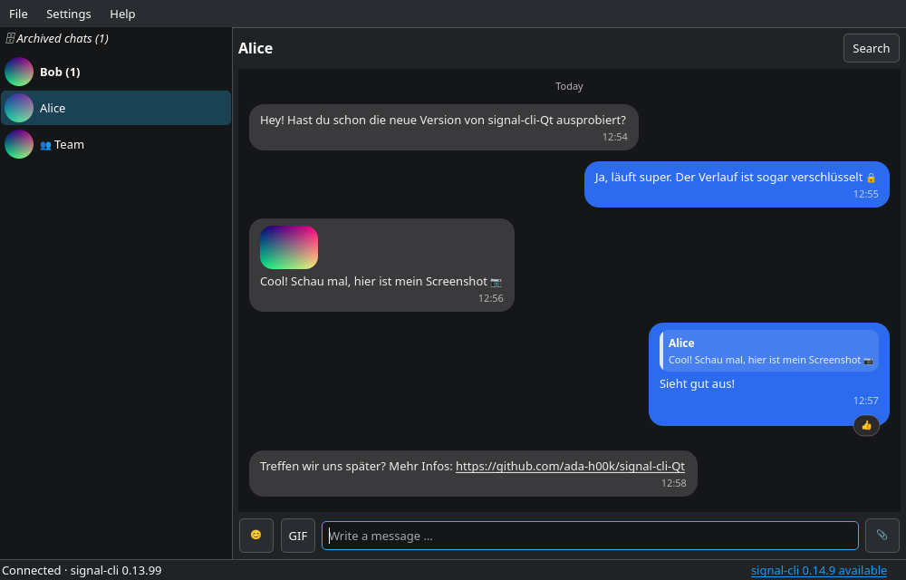

# signal-cli Qt

| Light (Breeze Light) | Dark (Breeze Dark) |
| --- | --- |
|  |  |

A native Qt 6 GUI for [signal-cli](https://github.com/AsamK/signal-cli) with
an **encrypted local chat history**.

## Architecture

| Part | Language | Job |
|------|----------|-----|
| `src/` – GUI | C++ / Qt 6 Widgets | Windows, chat view, talking to signal-cli |
| `history-store/` – encrypted history | **Rust** | Everything that is new compared to signal-cli: key derivation, encryption, tamper detection, file format |
| signal-cli | (external, Java/native) | Installed by you, **not** part of this project |

### signal-cli stays independent

- signal-cli must be installed separately (package manager, release archive, …).
- The GUI only starts the `signal-cli` executable as a child process:
  one-shot commands (`--version`, `-o json listAccounts`, `link -n <name>`) and
  `signal-cli -a <number> jsonRpc` (JSON-RPC over stdin/stdout).
- No signal-cli code or library is linked, so updating signal-cli never
  requires rebuilding the GUI. After an update choose `File → Reconnect`.
- `Help → Check for signal-cli update` compares your installed version with the
  latest GitHub release (a silent check also runs at startup and only shows a
  hint in the status bar). You perform the update yourself.
- The path is looked up in `PATH` and can be changed under
  `Settings → Path to signal-cli …`.

### Encrypted chat history (Rust)

signal-cli does not keep a chat history, so the GUI stores one itself in
`history.scq` (in the application data directory, see *About*). Design:

- A random 256-bit **data key** encrypts every message with
  **XChaCha20-Poly1305** (random 192-bit nonce per record).
- The data key is wrapped using **Argon2id** (64 MiB, 3 passes). By default, the
  secret is random and kept in the system keychain; alternatively, you can use a
  passphrase. Changing the protection only re-wraps the key.
- Every record is authenticated together with its sequence number: modified,
  swapped or removed (non-final) records are detected and refused.
- Writes are append-only and `fsync`ed; compaction (deleting a conversation)
  and protection changes use atomic temp-file + rename. A torn last record
  after a crash is dropped automatically.
- The file is created with mode `0600`; keys are zeroized when dropped
  (best effort).
- Rust code is a static library with a small C ABI
  (`history-store/include/history_store.h`), covered by unit and FFI tests
  (`cargo test`).

With keychain protection, the history unlocks automatically while the system
keychain is available. With passphrase protection, you enter the passphrase at
every start. A passphrase cannot be recovered if forgotten; keychain-protected
history depends on retaining access to the system keychain. Use
`Settings → History protection …` to switch protection methods.

#### What is *not* protected

- signal-cli's own data directory (`~/.local/share/signal-cli`: account keys,
  sessions, contacts, attachments) is managed by signal-cli and is **not**
  encrypted by this program. Use full-disk/home-directory encryption for that.
- Decrypted messages and previews exist in RAM while the app runs; attachments
  you *open* are written to a temporary directory until the app exits.
- A screenshot pasted from the clipboard is saved as a temporary file until the
  app exits; afterwards only its preview (≤ 480 px) remains in the history.
- The file reveals the number and approximate size of messages (no padding),
  and an attacker with write access could delete the *last* records unnoticed.

## Features

- Choose an account / link this device via QR code (`signal-cli link`)
- Contacts and groups, conversation list with unread counters
- **Replies (quotes):** receive and display them; reply via the message
  context menu, click a quote to jump to the original
- **Attachments:** send files with the 📎 button, drag & drop, or by pasting:
  `Ctrl+V` / `Shift+Insert` (or right-click → *Attach from clipboard*) turns a
  **screenshot** in the clipboard, or files copied in a file manager, into an
  attachment with a small preview above the input field. If the clipboard also
  holds real text (e.g. copied from a document), the text is pasted instead.
  Receive and save attachments (context menu → *Save …*, or click to open).
  Files of risky types (`.exe`, `.sh`, …) are never opened directly, only saved
- **Inline images:** received and sent pictures are shown in the chat;
  click for the full size
- **Inline videos:** click a sent or received video to play it directly in the chat;
  pause or resume with the on-video control
- **Audio messages and files:** play received audio directly from its chat attachment;
  click again to pause or resume. The chat shows playback progress and duration.
- **Edit messages:** right-click one of your own text messages → *Edit*. The text moves into the
  input field (or press ↑ with an empty input; Shift+↑ selects the whole current draft).
  Enter saves, Esc or ✕ cancels and restores what you had typed. Same limits as the
  official clients: up to 3 hours after sending and at most 10 edits. Edited messages show
  *edited* next to the time. Edits by contacts and edits made on your phone are applied as well
  (only to a known message of the same author). The edit is stored in the encrypted history.
- **Disappearing messages:** right-click a chat to choose the Signal timer (off, 30 seconds,
  1 minute, 5 minutes, 1 hour, 6 hours, 12 hours, 1 day, 1 week or 4 weeks). The setting is
  synchronized with Signal for contacts and groups. New outgoing messages use that timer;
  incoming messages start their local timer when the chat is opened. Expired messages are
  removed from the encrypted history as well.
- **Delete messages:** right-click a message to delete it from this device. Your own messages
  can also be deleted for everyone within Signal's 24-hour window. Local deletion compacts the
  encrypted history so the removed message and its reactions are no longer stored.
- **Reactions:** react from the context menu (quick set or full picker);
  choose the same emoji again to take it back; incoming reactions are shown
  below the message
- **Emoji:** picker next to the input field
- **GIF search:** use the *GIF* button beside the composer to search GIPHY or browse trending
  GIFs, then select a result to send it in the current chat. Configure a GIPHY API key under
  `Settings → GIPHY API key …`; the picker includes GIPHY attribution.
- **Rounded message bubbles** like the official client: own messages on the
  right, received ones on the left, date separators, timestamps, clickable
  links, text selection within a message (double-click selects a word,
  `Ctrl+C` copies)
- **Appearance:** `Settings → Appearance …` lets you change the colour of your
  bubbles, received bubbles, their texts and the chat background, plus the
  corner radius, with a live preview. Untouched colours keep following a light
  or dark system theme. *Reset to defaults* restores them
- **Profile settings:** `Settings → Profile settings` lets you view/change your
  Signal username, set your display name, choose an avatar image, or remove the avatar
- **Profile settings:** `Settings → Profile settings …` opens a window of its own with your
  Signal username, display name and avatar (change / remove), like *Appearance*
- **Tray icon:** shows an unread counter (also in the window title and tooltip).
  Closing the window can keep the app running in the tray; click the icon to
  show/hide it, quit from the tray menu or *File → Quit*
- **Desktop notifications** and a **sound** for new messages, each with its own
  switch – you can have either, both or none (`Settings → Notifications & sound …`).
  Notifications can show name and message, name only, or nothing; clicking one opens
  the chat. A newer notification from the same chat replaces the old one
- **Sound:** three built-in sounds (Chime, Pop, Ding) or your own file, with a *Test* button
- Neither notification nor sound is triggered while you look at that conversation, nor for
  chats you **muted** (right-click a chat → *Mute notifications*; kept in the encrypted history)
- **Archived chats:** archived contacts are shown in an *Archived chats*
  folder (see below), like the official client
- Persistent, encrypted history; delete single conversations (right-click) –
  the file is compacted so the old ciphertext is gone
- Protect the history with the system keychain by default, or use a passphrase
  instead (`Settings → History protection …`)

### Archived chats

- Contacts you archived on your phone appear in the *Archived chats* folder
  at the top of the list (click it, *← Back to chats* to return). signal-cli
  reports this as `isArchived` in `listContacts`.
- A new message (sent or received) moves a chat out of the archive again,
  as in the official client.
- You can also archive/unarchive any chat locally (right-click). That state is
  kept in the encrypted history and is only overwritten when signal-cli
  reports a *change* (e.g. you unarchive on the phone).
- **Groups:** signal-cli does not report the archive state of groups, so
  they cannot be synchronised; archive them locally if you like.
- The state only arrives if your phone synced it to signal-cli; this is
  outside of the GUI's control.

### Attachments and the history

- Images keep a small preview (≤ 480 px) **inside the encrypted history**, so
  they are still displayed after a restart without signal-cli.
- Full-size files are fetched from signal-cli on demand (`getAttachment`).
  signal-cli keeps its own (unencrypted) copies in its data directory.
- *Open* writes a temporary copy that is removed when the app exits.

## Downloads

Every commit pushed to `main` or `master` is built by GitHub Actions and published
as a release tagged `build-<commit SHA>`:

| File | Description |
|------|-------------|
| `signal-cli-qt-linux-x86_64` | Linux x86_64 executable. Dynamically links to Qt; it does not bundle runtime libraries. |
| `signal-cli-qt-linux-x86_64-installer.tar.gz` | Install bundle containing the executable, `install.sh`, desktop launcher, and icon. |
| `SHA256SUMS` | SHA-256 checksums for the executable and installer archive. |

Linux x86_64 only. Install Qt 6 runtime libraries (Widgets, Network, Multimedia
and MultimediaWidgets), QtKeychain 0.14 or newer, and a system credential store.
The installer does not install dependencies or `signal-cli`; install
`signal-cli` separately and make sure its executable is on `PATH`.

To install, download the standalone executable, installer archive, and
`SHA256SUMS`. Verify the downloads, extract the archive, and run the included
installer:

```sh
sha256sum -c SHA256SUMS
tar -xzf signal-cli-qt-linux-x86_64-installer.tar.gz
./install.sh
```

The installer adds the application to your desktop's application menu, installs
its icon, places the executable in `~/.local/opt/signal-cli-qt/`, and creates a
command link at `~/.local/bin/signal-cli-qt`. It makes no system-wide changes
and does not require `sudo`. Run it again after downloading a newer release to
update the installation.

## Build from source

Requirements: C++17 compiler, CMake ≥ 3.16, Qt 6 (Widgets, Network, Multimedia),
QtKeychain 0.14 or newer,
**Rust ≥ 1.75 with cargo** (e.g. via [rustup](https://rustup.rs) or your distro).

```sh
# Debian/Ubuntu
sudo apt install build-essential cmake qt6-base-dev qt6-multimedia-dev qtkeychain-qt6-dev cargo qrencode

cmake -S . -B build
cmake --build build -j
./build/signal-cli-qt

# Rust tests only
cargo test --release --manifest-path history-store/Cargo.toml
```

`qrencode` is optional; it is needed to show the QR code when linking a device.
Without it only the link URI is shown. `Cargo.lock` is committed and the build
uses `--locked`; some dependencies are pinned to versions that still build on
older Rust toolchains.

The GIPHY API key and the default history key are stored in the operating system
credential store through QtKeychain. On Linux, a Secret Service provider such as
GNOME Keyring or KWallet must be available. Existing GIPHY keys in `QSettings`
are migrated when first read. Existing history files protected by a passphrase
remain passphrase-protected until you switch them using the File menu.

## CI / release workflow

`.github/workflows/release.yml` runs on pushes to `main` or `master`, and can
also be started manually:

1. install Qt 6.12 and Rust, run `cargo test` for the history store
2. build with CMake (which invokes cargo)
3. package the standalone executable and an installer archive with its menu resources
4. publish both, with checksums, as a GitHub release tagged `build-<commit SHA>`

No secrets are needed (default `GITHUB_TOKEN` with `contents: write`).
One release per commit accumulates quickly – delete old ones from time to time.

### Notifications, sound and tray – how they work

- **Notifications** use the freedesktop.org Notifications service over D-Bus (what GNOME,
  KDE, … provide), independent of the tray icon. Where that service is missing, and on other
  platforms, the tray icon's own messages are used if the tray icon is shown.
- **Sound** is played by the desktop's command line player (`pw-play`, `paplay`,
  `canberra-gtk-play`, `aplay`, `play`; `afplay` on macOS) instead of Qt Multimedia, so
  there is no extra dependency and any format the player understands works. If none is
  found you get the system beep, and the settings dialog tells you.
- **Tray icon:** needs a system tray (StatusNotifier). GNOME has none by default (install
  the AppIndicator extension); then the setting is greyed out and closing the window simply
  quits.
- **Mute:** signal-cli does not report whether a chat is muted on your phone, so muting is
  local to this app.

## Troubleshooting

- **Every call to signal-cli is logged to the terminal** (command, result, duration;
  phone numbers are masked). Start the app from a terminal to see it, e.g.
  `signal-cli: signal-cli -o json listAccounts -> exit code 1 (1530 ms) | stderr: …`.
  Set `SIGNAL_CLI_QT_DEBUG=1` to see unmasked output.
- If signal-cli cannot be run or fails, the app says so with the command and the
  error message. It reports *"no account"* only if signal-cli itself returns an
  empty account list. The window never blocks while signal-cli starts.
- `qt.qpa.services: Failed to register with host portal … App info not found for
  'signal-cli-qt'` is harmless. It appears when a desktop application ID is announced
  but no matching `.desktop` file is installed; the app now announces its ID only if
  one exists.
## Tests

```sh
cargo test --release --manifest-path history-store/Cargo.toml   # Rust: crypto, file format, C ABI

cmake -S . -B build -DSIGNAL_CLI_QT_TESTS=ON && cmake --build build
ctest --test-dir build --output-on-failure                        # headless GUI test
```

The GUI test starts the real `MainWindow` (offscreen) against
`tests/mock-signal-cli.py`, a small stand-in for signal-cli that uses the JSON
field names of signal-cli's source. It covers first start / unlock, the
status bar (no phone number), archive folder, quotes, image thumbnails, attachments, reactions, sync messages,
persistence across a restart and that no message text is visible in the file.
`alerts_test` starts fake D-Bus services (notifications and a tray host) and a fake
`paplay`, and checks every combination of notification/sound on and off, content
settings, groups, attachments, mute, rate limiting, clicking a notification, the tray
(hide on close, unread counter, quit) and the settings dialog. It needs
`dbus-run-session` and, for the tray part, `xvfb-run`.
`startup_test` runs the real window against a mock that fails, returns an empty
list, is slow, or exits non-zero after printing valid data, and checks that the app
shows the real error, never blocks, and still connects when the output is valid.
A further test (`chatview_test`) renders the bubble view offscreen and checks
rounded corners, the configurable colours, layout, clicks on links /
attachments / quotes, text selection, scrolling and saving of the appearance
settings. It does **not** replace testing against a real signal-cli account.

## Known limitations

- No voice notes, stickers, link previews or mentions yet.
- Editing: only the text; the previous versions are not kept (no edit history view), and
  multi-line messages (sent from other devices) cannot be edited here because the input is
  single-line.
- Text can be selected within one message only (not across messages); use
  *Copy message text* in the context menu otherwise.
- Only one account is connected at a time; messages are single-line input.
- The whole history is decrypted into memory at startup (previews included);
  very large histories would need lazy loading.
- Unread counters are not persisted across restarts.
- Signal eventually rejects outdated clients, so keep signal-cli up to date –
  which is what the update check is for.
