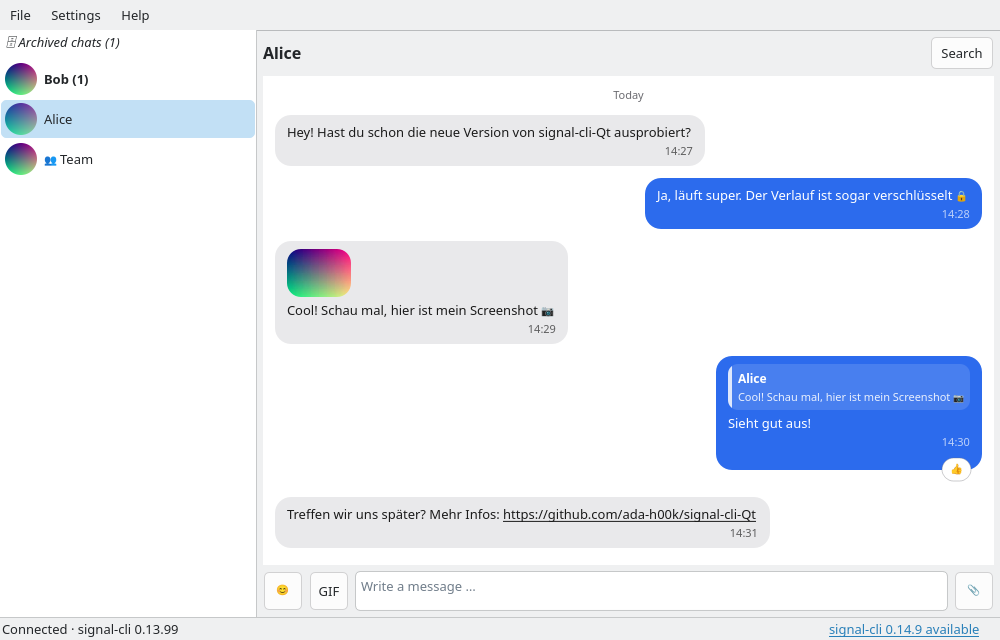
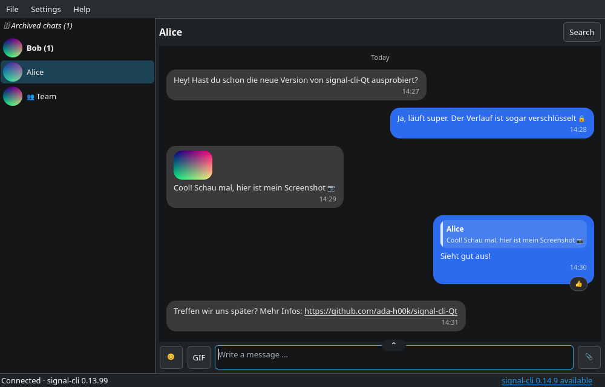
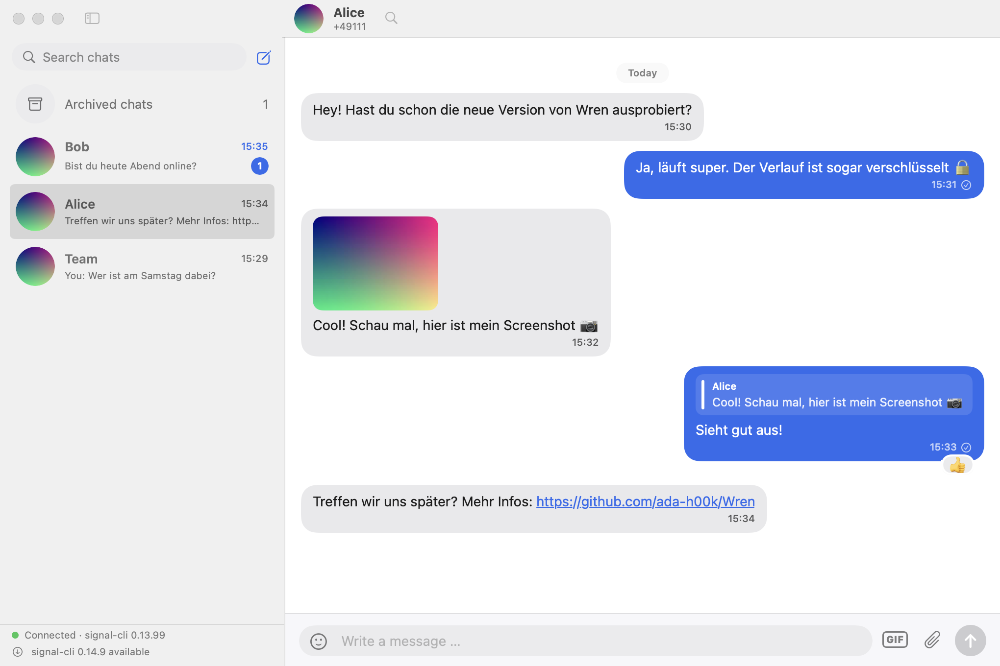
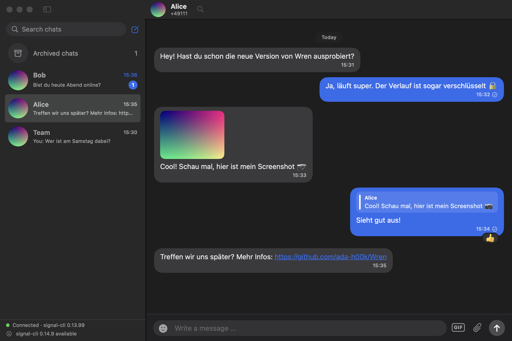

# Corvus

Corvus is a desktop interface for [signal-cli](https://github.com/AsamK/signal-cli) with an encrypted local chat history. The Qt app runs on Linux, Windows and macOS; macOS also has a native SwiftUI app.

### Linux and Windows (Qt)

| Breeze Light | Breeze Dark |
|---|---|
|  |  |

### macOS (Swift / SwiftUI)

| Light theme | Dark theme |
|---|---|
|  |  |

## Features

- Link Corvus to your Signal account using `signal-cli`.
- Read and send messages, including group chats, replies and reactions.
- Send and receive files, images, video and audio.
- Edit or delete messages, manage archived chats and disappearing messages.
- Desktop notifications, notification sounds and a tray/menu-bar icon.
- Encrypted local chat history, protected by the system keychain or a passphrase.
- Customisable chat colours and appearance.

Corvus is a graphical client, not a replacement for `signal-cli`. You must have `signal-cli` installed and linked to your Signal account. The Windows installer can download it for you.

## Install

Download the appropriate package from the [latest GitHub release](https://github.com/ada-h00k/Corvus/releases/latest).

### Linux (Qt, x86_64)

1. Download `corvus-linux-x86_64-installer.tar.gz` from the release.
2. Extract it and run the installer:

   ```sh
   tar -xzf corvus-linux-x86_64-installer.tar.gz
   ./install.sh
   ```

The installer is per-user, does not need `sudo`, and adds Corvus to your application menu. Run it again to update; run `./install.sh --uninstall` to remove it.

The prebuilt executable is dynamically linked and does not include Qt libraries. You need a compatible Qt 6 runtime (the release is built with Qt 6.12), QtKeychain 0.14 or newer, and a desktop keyring such as GNOME Keyring or KWallet. Install `signal-cli` separately and make sure it is available on your `PATH`.

**Arch Linux:** download the `corvus-*.pkg.tar.zst` package from the release and install it with:

```sh
sudo pacman -U ./corvus-*.pkg.tar.zst
```

Install `signal-cli` separately, for example from the AUR.

### Windows (Qt, x86_64)

1. Download and run `corvus-windows-x64-setup.exe` from the release.
2. Follow the setup wizard. It installs the Qt runtime and `qrencode` (used to show the QR code when linking a device) with Corvus.
3. On the `signal-cli` step, you can optionally let the installer download `signal-cli` and a private Java runtime.

The installer is for Windows 10 or newer. It does not require administrator rights for a per-user installation. The setup is not code-signed, so Windows SmartScreen may show a warning.

**Portable version:** download `corvus-windows-x64-portable.zip`, extract it, and run `corvus.exe` (`qrencode.exe` is included). You must install and configure `signal-cli` yourself for this option.

### macOS (recommended: Homebrew)

Corvus has two macOS versions. Install the one you prefer:

- **Swift / SwiftUI** — native macOS interface; requires macOS 14 or newer.
- **Qt** — the same cross-platform interface used on Linux and Windows.

First add the Corvus tap and install `signal-cli` if it is not already installed:

```sh
brew tap ada-h00k/corvus
brew install signal-cli
```

Then install **one** version:

```sh
brew install --cask corvus-swift
```

Or, for the Qt version:

```sh
brew install --cask corvus-qt
```

You can also download `corvus-macos-arm64.zip` (Swift) or `corvus-qt-macos-arm64.zip` (Qt) from the [latest release](https://github.com/ada-h00k/Corvus/releases/latest). Prebuilt macOS releases are for Apple silicon (arm64).

The release apps are ad-hoc signed rather than notarised. Depending on your macOS security settings, the first launch may require opening the app from Finder using **right-click → Open**. Only bypass a warning if you trust the source of the app.

The Swift and Qt versions use the same local history. Do not run both versions at the same time.

## First launch

Corvus starts `signal-cli` as a separate program. If it cannot find it, open **Settings → Path to signal-cli** and select the executable. Follow Corvus's account-linking prompt if you have not linked this installation to Signal yet.

On macOS, `signal-cli` can be installed with Homebrew as shown above. On Linux, use your distribution's package instructions or the [official signal-cli releases](https://github.com/AsamK/signal-cli/releases). The Windows setup wizard can install it for you.

## Local data and encryption

Corvus stores its chat history in an encrypted `history.corvus` file. By default, the history key is stored in your operating system's keychain; you can switch to passphrase protection in **Settings → History protection**.

- Linux: `~/.local/share/corvus/corvus/`
- macOS: `~/Library/Application Support/corvus/corvus/`
- Windows: `%APPDATA%\corvus`

**Upgrading from Wren:** Corvus was called Wren before (and signal-cli Qt before that). On first start it moves the existing chat history, settings and keychain entries (history key, GIPHY API key) over automatically; nothing is deleted. If the old version is still running, close it first. The Linux installer and the Arch package replace an existing Wren installation; on macOS you can delete the old `Wren.app`, and macOS may ask once for permission to read the old keychain entries.

**Important:** Corvus's encryption protects its local chat history. It does not encrypt `signal-cli`'s own account data, sessions, contacts or attachments. Protect your home directory or disk with your operating system's disk-encryption feature. A forgotten history passphrase cannot be recovered.

## Build from source

The Qt app requires a C++17 compiler, CMake 3.16 or newer, Qt 6 (Widgets, Network, Multimedia, MultimediaWidgets and Svg), QtKeychain 0.14 or newer, and Rust with Cargo.

On Debian/Ubuntu, install the build dependencies and compile:

```sh
sudo apt update
sudo apt install build-essential cmake ninja-build qt6-base-dev qt6-multimedia-dev qt6-svg-dev qtkeychain-qt6-dev cargo rustc

cmake -S . -B build -G Ninja -DCMAKE_BUILD_TYPE=Release
cmake --build build --parallel
./build/corvus
```

For the native Swift app, install Xcode and Rust, then run:

```sh
cd macos
./scripts/build-app.sh
open build/Corvus.app
```

The Swift app requires macOS 14 or newer. See [`macos/README.md`](macos/README.md) for Swift-specific development notes.

## License

Corvus is licensed under the [GNU Affero General Public License v3.0](LICENSE). `signal-cli` is a separate project and is distributed under its own license.
