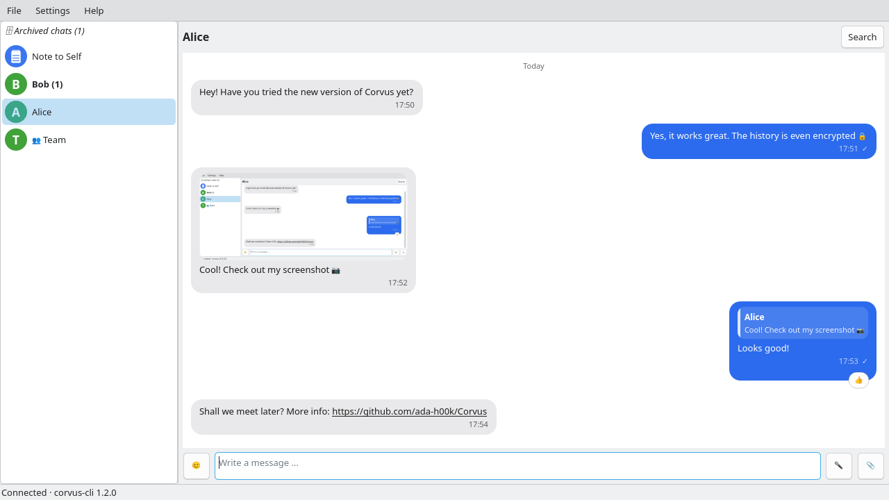
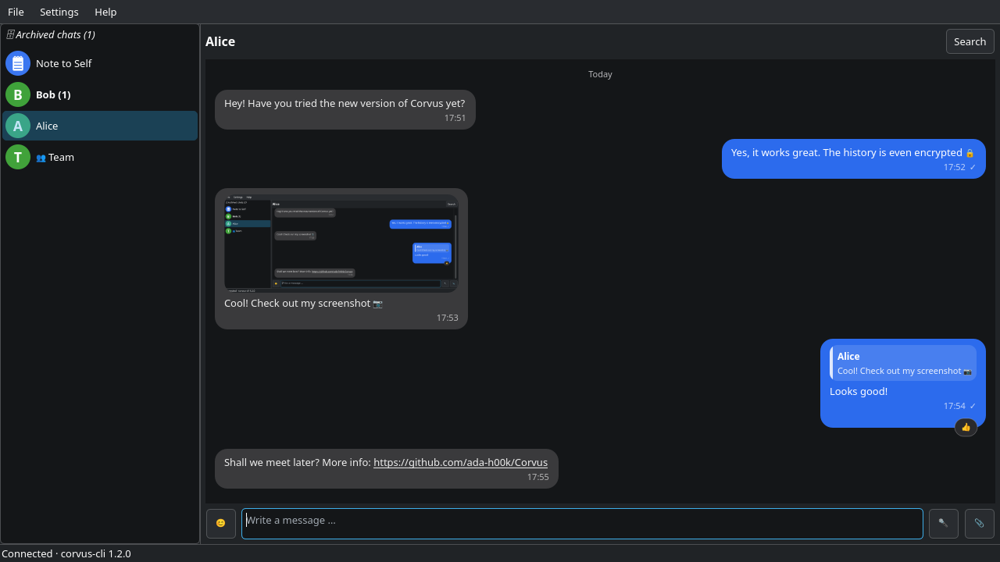
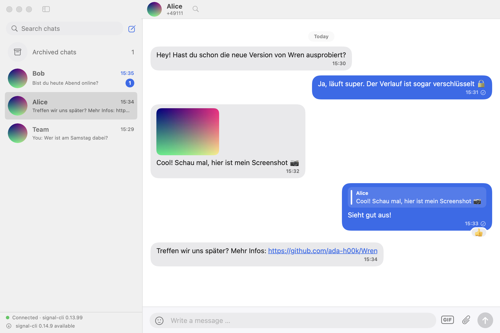
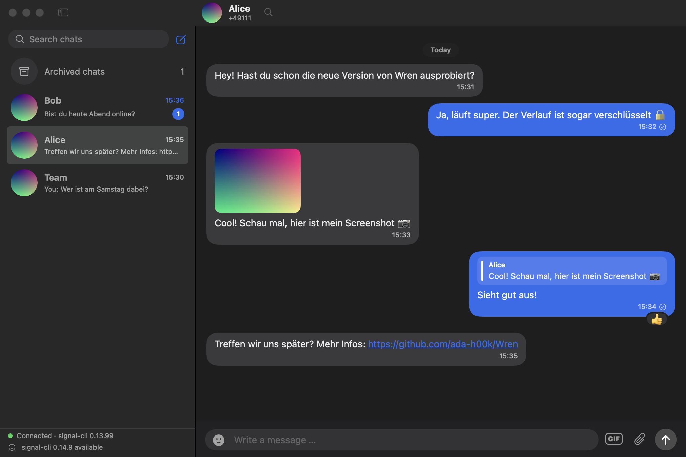

# Corvus

Corvus is a desktop client for Signal with an encrypted local chat history. It uses [corvus-cli](https://github.com/ada-h00k/corvus-cli) as its backend. The Qt app runs on Linux, Windows and macOS; macOS also has a native SwiftUI app.

### Linux and Windows (Qt)

| Breeze Light | Breeze Dark |
|---|---|
|  |  |

### macOS (Swift / SwiftUI)

| Light theme | Dark theme |
|---|---|
|  |  |

## Features

- Link Corvus to your Signal account with `corvus-cli`.
- Read and send messages, including group chats, replies and reactions.
- Send and receive files, images, video and audio.
- Edit or delete messages, manage archived chats and disappearing messages.
- Desktop notifications, notification sounds and a tray/menu-bar icon.
- Spell checking in the message field (Linux, with Hunspell dictionaries).
- Encrypted local chat history, protected by the system keychain or a passphrase.
- View a contact's safety number and mark the contact as verified (Qt version; right-click a chat → *View safety number …*).
- Record and send voice messages (Qt version; 🎤 button next to the ➕ button; requires `corvus-cli` to arrive as a voice note).
- Send and receive Signal View Once photos (Qt version; select exactly one image and press **1×**; requires `corvus-cli`).
- Share a contact card from the ➕ menu like in the official clients (Qt version; name, phone number and avatar as a native Signal contact message — the full-width Message button below the card opens, or creates, the chat with that contact; like the official clients the button is only shown when the contact is messageable, i. e. the card carries a phone number or the 16-byte serviceId (`aciBinary`) that `corvus-cli` 1.6.0 sends and reads; requires `corvus-cli` 1.6.0 or newer).
- Create Signal polls and vote in them, like in the official clients (Qt version; ➕ menu → **Poll**, click an option to vote, the author can end the poll early; requires `corvus-cli` 1.4.0 or newer).
- Forward text messages, attachments and stickers to up to five chats at once (Qt version; right-click a message → **Forward…**).
- Customisable chat colours and appearance.

Corvus is a graphical client; the connection to Signal is handled by `corvus-cli`, a separate backend program linked to your Signal account. It is a single native executable written in Rust (built on [presage](https://github.com/whisperfish/presage)) and does not need Java. The Flatpak, the AppImage and the Windows setup include it, so there is nothing else to install there.

`corvus-cli` uses JSON-RPC to communicate with Corvus and keeps its own device link and account data. Link the computer with your phone as a new device when setting it up; Corvus keeps its local chat history.

## Install

Download the appropriate package from the [latest GitHub release](https://github.com/ada-h00k/Corvus/releases/latest).

### Linux (Qt, x86_64)

**Recommended: Flatpak**

[](https://flatpark.org/apps/io.github.ada_h00k.Corvus)

Add the FlatPark repository and install Corvus:

```sh
flatpak remote-add --if-not-exists --user flatpark https://dl.flatpark.org/flatpark.flatpakrepo
flatpak install --user flatpark io.github.ada_h00k.Corvus
```

The Flatpak includes [`corvus-cli`](https://github.com/ada-h00k/corvus-cli) and `qrencode`, so nothing else has to be installed.

The history key (and the GIPHY API key) is stored through the Flatpak Secret portal, so Corvus does not get access to your system keyring or to the passwords of other applications. This needs a portal backend that implements the Secret portal; if your desktop has none, protect the history with a passphrase instead.

**Other installation methods**

**AppImage:** download `corvus-linux-x86_64.AppImage` from the release, make it executable and run it:

```sh
chmod +x corvus-linux-x86_64.AppImage
./corvus-linux-x86_64.AppImage
```

Like the Flatpak, the AppImage includes Qt, [`corvus-cli`](https://github.com/ada-h00k/corvus-cli), `qrencode`, Hunspell and the Hunspell dictionaries (German, English, French, Spanish, Italian), so nothing else has to be installed. Unlike the Flatpak it is not sandboxed: it has normal access to your files and stores the history key in the system keyring (Secret Service, for example GNOME Keyring or KWallet; without one, protect the history with a passphrase). It is built on Ubuntu 24.04 and needs glibc 2.39 or newer. If you use a launcher such as AppImageLauncher, it adds Corvus to your application menu.

**Updating the AppImage:** it contains update information, so the usual AppImage tools can update it in place and only download the parts that changed: [AppImageUpdate](https://github.com/AppImageCommunity/AppImageUpdate) (`appimageupdatetool corvus-linux-x86_64.AppImage`), Gear Lever, AppImageLauncher or similar. Each release also contains `corvus-linux-x86_64.AppImage.zsync`, which these tools use; you do not need to download it yourself.

The standalone installer is also available from the [latest GitHub release](https://github.com/ada-h00k/Corvus/releases/latest). Download `corvus-linux-x86_64-installer.tar.gz`, extract it and run:

```sh
tar -xzf corvus-linux-x86_64-installer.tar.gz
./install.sh
```

The installer is per-user, does not need `sudo`, and adds Corvus to your application menu. Run it again to update; run `./install.sh --uninstall` to remove it.

The prebuilt executable is dynamically linked and does not include Qt libraries. You need a compatible Qt 6 runtime (the release is built with Qt 6.12), QtKeychain 0.14 or newer, Hunspell 1.7 (`libhunspell`) and a desktop keyring such as GNOME Keyring or KWallet. Install `corvus-cli` separately and make sure it is available on your `PATH`: download `corvus-cli-linux-x86_64` from the [corvus-cli releases](https://github.com/ada-h00k/corvus-cli/releases/latest), rename it to `corvus-cli` and make it executable (`chmod +x`).

**Arch Linux:** download the `corvus-*.pkg.tar.zst` package from the release and install it with:

```sh
sudo pacman -U ./corvus-*.pkg.tar.zst
```

Install `corvus-cli` separately from the [corvus-cli releases](https://github.com/ada-h00k/corvus-cli/releases/latest).

### Windows (Qt, x86_64)

1. Download and run `corvus-windows-x64-setup.exe` from the release.
2. Follow the setup wizard. It installs the Qt runtime, `qrencode` (used to show the QR code when linking a device) and [`corvus-cli`](https://github.com/ada-h00k/corvus-cli) with Corvus. There is no Java or separate backend download needed.
3. On first start, Corvus finds `corvus-cli` by itself and offers to link the computer with your phone as a new device.

The installer is for Windows 10 or newer. It does not require administrator rights for a per-user installation. The setup is not code-signed, so Windows SmartScreen may show a warning.

### macOS (recommended: Homebrew)

Corvus has two macOS versions. Install the one you prefer:

- **Swift / SwiftUI** — native macOS interface; requires macOS 14 or newer.
- **Qt** — the same cross-platform interface used on Linux and Windows.

First add the Corvus tap and install **corvus-cli**, the Signal backend. The Homebrew cask downloads the latest Apple-silicon binary and makes it available as `corvus-cli` on your `PATH`. You do not need Java or a separate manual download.

```sh
brew tap ada-h00k/corvus
brew install --cask corvus-cli
```

Then install **one** version of Corvus:

```sh
brew install --cask corvus-swift
```

Or, for the Qt version:

```sh
brew install --cask corvus-qt
```

You can also download `corvus-macos-arm64.zip` (Swift) or `corvus-qt-macos-arm64.zip` (Qt) from the [latest release](https://github.com/ada-h00k/Corvus/releases/latest). Prebuilt macOS releases are for Apple silicon (arm64).

The release apps are ad-hoc signed rather than notarised. Depending on your macOS security settings, the first launch may require opening the app from Finder using **right-click → Open**. Only bypass a warning if you trust the source of the app.

The Swift and Qt versions use the same local history. Do not run both versions at the same time.

## First launch

Corvus starts `corvus-cli` as a separate program. On a first start it uses the bundled `corvus-cli` where available (Windows and Flatpak), otherwise it looks for `corvus-cli` on your `PATH`. An executable you chose manually is always kept. If Corvus cannot find `corvus-cli`, open **Settings → Advanced → Choose …** and select the executable. Follow Corvus's account-linking prompt if you have not linked this installation to Signal yet.

The Windows builds and the Flatpak include `corvus-cli`. On Linux installations without the Flatpak, get it from the [corvus-cli releases](https://github.com/ada-h00k/corvus-cli/releases/latest). On macOS, install the `corvus-cli` backend with `brew install --cask corvus-cli` as shown above.

**Updates of the backend:** **Help → Check for backend update** (also in Settings → Advanced) checks `corvus-cli` by build. It reports its commit in `--version`, and the latest [corvus-cli release](https://github.com/ada-h00k/corvus-cli/releases/latest) is compared with it. The Flatpak and the Windows setup bring a new `corvus-cli` with the next Corvus update.

## Local data and encryption

Corvus stores its chat history in an encrypted `history.corvus` file. By default, the history key is stored in your operating system's keychain; you can switch to passphrase protection in **Settings → History protection**.

- Linux: `~/.local/share/corvus/corvus/`
- macOS: `~/Library/Application Support/corvus/corvus/`
- Windows: `%APPDATA%\corvus`

`corvus-cli` keeps its own account data in `~/.local/share/corvus-cli/` (Windows: `%USERPROFILE%\.local\share\corvus-cli`; in the Flatpak below `~/.var/app/io.github.ada_h00k.Corvus/data/corvus-cli/`).

## Build from source

The Qt app requires a C++17 compiler, CMake 3.16 or newer, Qt 6 (Widgets, Network, Multimedia, MultimediaWidgets and Svg), QtKeychain 0.14 or newer, and Rust with Cargo.

On Debian/Ubuntu, install the build dependencies and compile:

```sh
sudo apt update
sudo apt install build-essential cmake ninja-build qt6-base-dev qt6-multimedia-dev qt6-svg-dev qtkeychain-qt6-dev libhunspell-dev cargo rustc

cmake -S . -B build -G Ninja -DCMAKE_BUILD_TYPE=Release
cmake --build build --parallel
./build/corvus
```

For the native Swift app, install Xcode and Rust, then run:

```sh
cd macos
./scripts/build-app.sh
open build/Corvus.app
```

The Swift app requires macOS 14 or newer. See [`macos/README.md`](macos/README.md) for Swift-specific development notes.

## License

Corvus is licensed under the [GNU Affero General Public License v3.0](LICENSE). `corvus-cli` is a separate project and is distributed under the AGPL-3.0.
