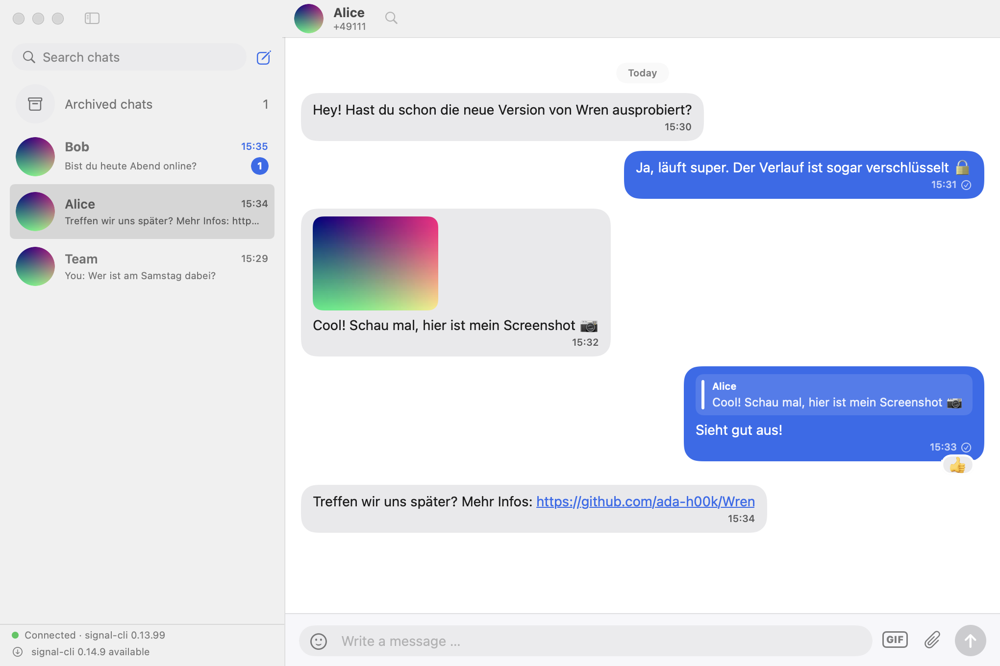
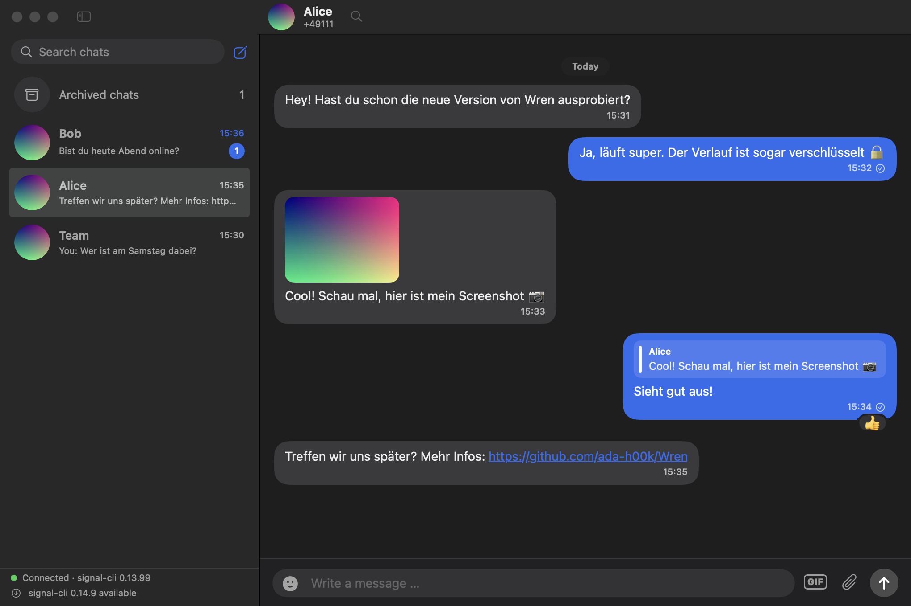

# Corvus

| Light | Dark |
| --- | --- |
|  |  |

This directory contains a native macOS version of Corvus, written in Swift / SwiftUI (macOS 14 or newer). It has the
same features and talks to corvus-cli the same way. It links the same Rust history store (`../history-store`), so the
`history.corvus` format, encryption and keychain entries are identical to the Qt app.

| Part | Job |
|------|-----|
| `Sources/CorvusCore` | UI-free logic: corvus-cli process / JSON-RPC, envelope parsing, history records, chat model, keychain |
| `Sources/CorvusMac` | SwiftUI app: window, chat view, composer, settings, notifications, menu bar icon |
| `Sources/CHistoryStore` | module map for `history-store/include/history_store.h` |

Requirements: Xcode (its toolchain provides the SwiftUI macros; the Command Line Tools alone are not
enough), Rust with cargo, and corvus-cli (`brew install --cask corvus-cli`).

```sh
scripts/build-app.sh            # Rust store + Swift release build -> build/Corvus.app
open "build/Corvus.app"
swift test                      # unit tests (envelopes, records, Rust store round trip, mock corvus-cli)
```

If `xcode-select` points to the Command Line Tools, the script uses `/Applications/Xcode.app`
automatically; for `swift build`/`swift test` set `DEVELOPER_DIR=/Applications/Xcode.app/Contents/Developer`.

Differences from the Qt app:

- The tray icon is a menu bar icon with the unread count, and the Dock icon shows a badge.
- Notifications use the macOS notification centre. One notification per chat; clicking it opens the chat.
- Settings live in the standard Settings window (⌘,).
- The QR code for linking is drawn by the app itself, so `qrencode` is not needed.
- The composer is multi-line: Return sends, Shift+Return or Option+Return starts a new line.
- Clicking an attachment follows fixed rules (`Sources/CorvusCore/AttachmentPolicy.swift`). File name *and* content type
  are checked, and the stricter result wins:
  - images, audio and video are shown or played inside the app
  - files that can run code (`.sh`, `.command`, `.terminal`, `.app`, `.pkg`, scripts, files without an extension, …)
    are never opened, only saved
  - everything else is opened in the default app only after a confirmation dialog

  Every file Corvus writes from an attachment is marked as downloaded (quarantine), so Gatekeeper checks it before it runs.
  The app quarantines all files it creates (`LSFileQuarantineEnabled`); corvus-cli runs through the embedded helper
  `Contents/Helpers/corvus-signal-cli.app` so it does not inherit that and can load its native libraries.
- The history is stored in `~/Library/Application Support/corvus/corvus/`, the same
  location a Qt build on macOS uses. Both apps read and write every record field of the other
  (`Sources/CorvusCore/Records.swift` mirrors `src/Records.cpp`), so switching between them loses nothing.
- Text formatting uses the Format menu (⌘B, ⌘I, ⇧⌘X strikethrough, ⇧⌘M monospace, ⇧⌘P spoiler) or the
  message field's context menu instead of the Qt app's floating formatting bar.
- Polls and contact cards are under the attach button's menu (the arrow next to the paperclip).
- Spell checking languages are chosen in macOS (Edit → Spelling and Grammar), not in a Corvus menu.
- "Bounce the Dock icon for new messages" takes the place of "Flash the taskbar".

The release workflow (`.github/workflows/release.yml`) builds and tests the app and attaches
`corvus-macos-arm64.zip` (Apple silicon) to every release. It is signed ad hoc only, so on
first launch open it with right-click → *Open*.

Debug builds (`swift build`) accept `SIGNAL_CLI_MAC_TEST_PASSPHRASE` and `SIGNAL_CLI_MAC_DEBUG_COMMANDS`
for unattended runs against `tests/mock-signal-cli.py` (see `Sources/CorvusMac/DebugHooks.swift`).

### Trying it without a second Signal account

The mock backend (`tests/mock-signal-cli.py`) answers polls, contact cards, blocking, message requests
(contact "Dave" is an open request), safety numbers and trust like corvus-cli does. The app keeps its
history and settings in your user account, so try it as a separate macOS user (or after backing up
`~/Library/Application Support/corvus` and `defaults export` of the app's settings):

```sh
cp ../tests/mock-signal-cli.py /tmp/mock-corvus-cli && chmod +x /tmp/mock-corvus-cli
swift build
SIGNAL_CLI_MAC_TEST_PASSPHRASE=test .build/debug/CorvusMac   # then Settings → Signal backend … → /tmp/mock-corvus-cli
```

Incoming messages are simulated with `MOCK_INJECT=<file>`: every JSON line (an envelope) appended to that file
arrives as if it had been received, for example a poll, a pin, a View Once photo or a file named `invoice\u202Etxt.exe`:

```sh
MOCK_INJECT=/tmp/inject SIGNAL_CLI_MAC_TEST_PASSPHRASE=test .build/debug/CorvusMac &
echo '{"sourceNumber":"+49111","timestamp":1,"dataMessage":{"timestamp":1,"pollCreate":{"question":"Lunch?","options":["Pizza","Sushi"]}}}' >> /tmp/inject
```
